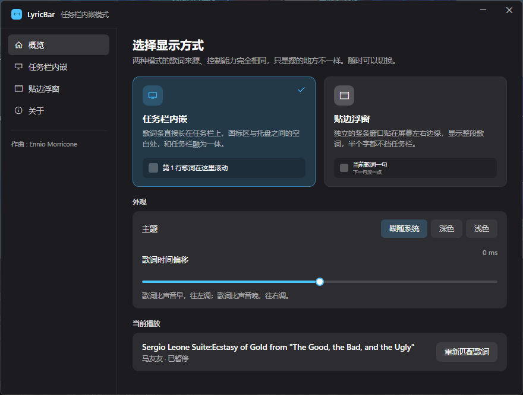
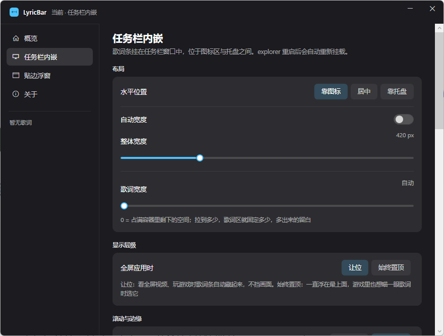
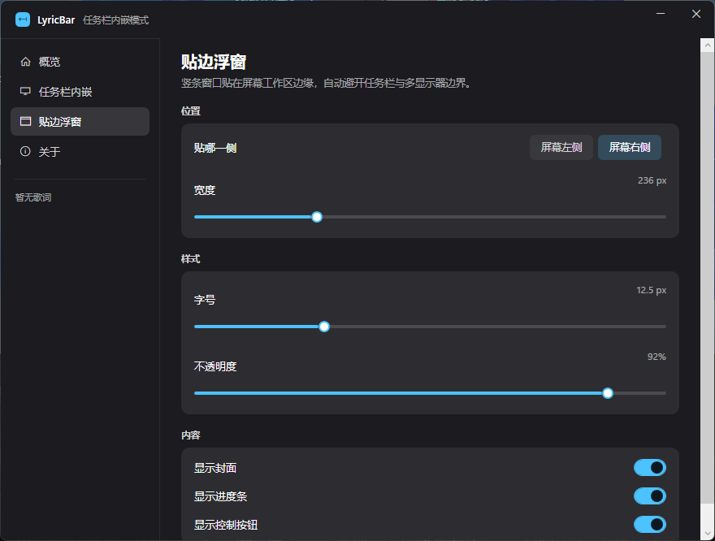
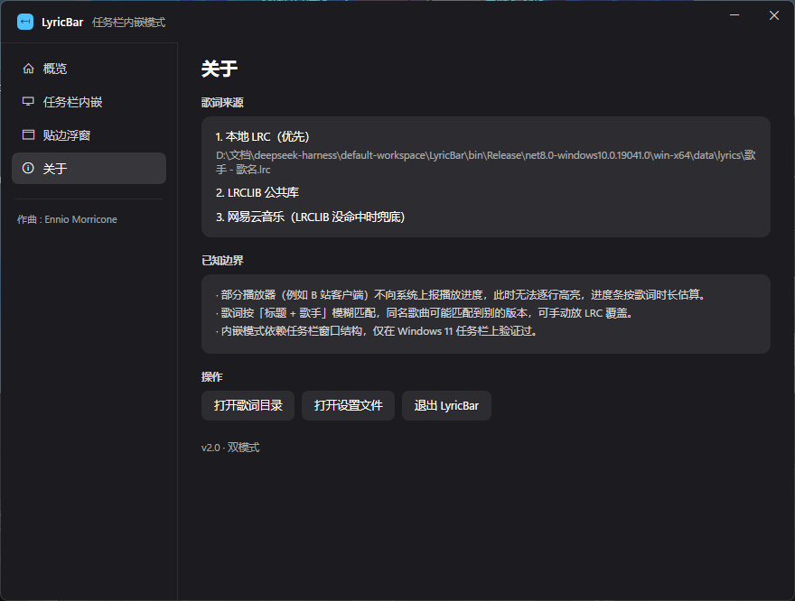
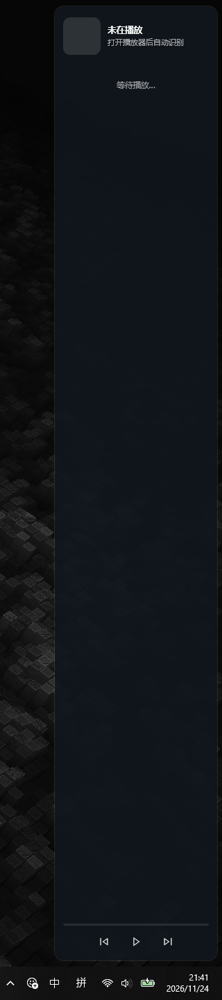
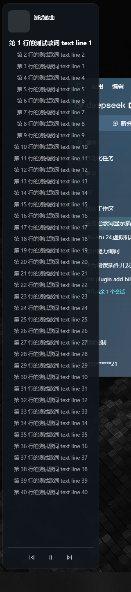

## 下载安装

不想自己编译的话，直接下安装包：

**[LyricBar-Setup.exe](https://github.com/Aether-whr/LyricBar/releases/download/v1.2.7/LyricBar-Setup.exe)** —— 67 MB，单文件，双击即装。

- 装到 `%LOCALAPPDATA%\Programs\LyricBar`，自动建桌面和开始菜单快捷方式，并把卸载入口写进「应用和功能」
- 不需要预装 .NET：程序本体自带 .NET 8 运行时
- 卸载：开始菜单「卸载 LyricBar」，或设置 → 应用 → LyricBar
- 首次运行 Windows 可能弹 SmartScreen（安装包未签名），点「更多信息 → 仍要运行」
# LyricBar — Windows 任务栏歌词条

在 **Windows 任务栏里**（图标区和托盘之间那段空白）直接显示当前播放的歌词，带封面、上一首 / 播放暂停 / 下一首按钮。另外还保留一种 **贴边浮窗** 形态：竖条贴在屏幕左右边缘，显示整段滚动歌词。

两种模式共用同一个播放引擎、同一套歌词源，在同一个设置界面里切换，各自有独立设置页。


鼠标移上去，右边的按钮展开、歌词区自动让位（背景不透明度设成 0 时只剩封面和字，完全融进任务栏）：


整条任务栏的样子：


## 构建

需要 .NET 8 SDK（或者直接用 Visual Studio 打开 `LyricBar.csproj`）：

```
dotnet build -c Release
dotnet publish -c Release -r win-x64 --self-contained true -o dist -p:DebugType=none
```

目标框架 `net8.0-windows10.0.19041.0`，用到 WinRT 的 `Windows.Media.Control`（SMTC），所以必须是 Windows 10 2004 / Windows 11 以上。

## 直接运行

```
dist\LyricBar.exe
```

- 首次启动会自动弹出设置界面，先选模式（默认「任务栏内嵌」）。
- `dist` 是自包含发布版（约 169 MB，内含 .NET 8 运行时），**不需要**另外装 .NET。仓库里不带这个目录，按上面的命令自己 publish 一次即可。
- 开机自启：`Win+R` → `shell:startup` → 把 `LyricBar.exe` 的快捷方式丢进去。
- 退出：托盘图标右键 → 退出，或者条上右键 → 退出。
- `LyricBar.exe --settings` 启动时直接打开设置界面。

## 设置界面

一个窗口，左边四项：概览 / 任务栏内嵌 / 贴边浮窗 / 关于。

**概览** —— 选模式、主题、歌词时间偏移、当前播放信息：



**任务栏内嵌** —— 水平位置（靠图标 / 居中 / 靠托盘）、整体宽度、歌词宽度、滚动方式与速度、边缘渐隐、歌名宽度比例、歌名滚动间隔、外观（纯文字 / 圆角卡片）、强调色融合度、字号、**背景不透明度**、显示项：



**贴边浮窗** —— 贴哪一侧、宽度、字号、不透明度、显示项：



**关于** —— 歌词来源、已知边界、打开歌词目录等：



设置实时生效并立即落盘（`%APPDATA%\LyricBar\settings.json`；写不进去时退到 exe 同目录 `data\settings.json`）。

主界面没有系统标题栏，**整个顶部标题栏（含左侧 Logo 区那一条空白）和左侧导航的空白处都可以拖动**；拖出屏幕会被夹回可见区域，不会丢。

## 贴边浮窗模式





## 它怎么工作

| 环节 | 做法 |
| --- | --- |
| 拿播放状态 | Windows SMTC（`GlobalSystemMediaTransportControlsSessionManager`）。网易云 / QQ音乐 / Spotify / PotPlayer / 浏览器 / B站客户端，凡接入系统媒体控制的都能读 |
| 切歌暂停 | 同一套 SMTC 的 `TryTogglePlayPauseAsync` / `TrySkipNextAsync` / `TrySkipPreviousAsync` |
| 找到任务栏 | `FindWindow("Shell_TrayWnd")` → 枚举子窗口，从 `ReBarWindow32` 取图标区右边缘、从 `TrayNotifyWnd` 取托盘左边缘，中间那段空白就是歌词条的位置 |
| 宽度 | **固定容器**：窗口宽度就是设置里的「整体宽度」（DIP），不随歌词长短伸缩，歌词换了条也不会左右跳。歌词区默认吃掉剩余空间，也可以单独拉一个固定宽度。勾了「自动宽度」才回到贴合内容的老行为（`FormattedText` 量当前这句） |
| 歌名独立 | 勾了「显示歌名」之后歌名是**单独的模块**（自己一列），不跟歌词一起滚。列宽上限 = **整体宽度 × 比例**（默认 40% 即 2/5，设置里 10%–70% 可调）；超出就滚动，**两次滚动之间停 1 秒**（0.2–5.0 s 可调），停 → 滚到底 → 再停 → 回卷循环；滚动时两端和歌词一样做**线性渐隐**。之前它和歌词在同一个 StackPanel 里，被歌词的位移拖着走 |
| 长歌词 | 默认「停-滚-停」（到头停 0.9 秒再回卷），也可以选「无缝连续」。位移用 `ThicknessAnimationUsingKeyFrames` 动 `Margin.Left`（布局层面，跟着渲染帧走），不是每 64 ms 改一次偏移量——后者受计时器 15.6 帧/秒的限制，还会被像素对齐反复取整，看着就是卡和抽搐。速度 10–200 px/s 可调。文字与阴影用 `BitmapCache` 只光栅化一次，之后整层平移；悬停让位期间（宽度每帧在变）延迟 220 ms 再重建动画，不会「一直弹回开头」 |
| 卡片底色 | 圆角卡片必须是分层窗口（`AllowsTransparency`），底色画在带 `CornerRadius` 的 `Shell` 上，窗口本身保持全透明——早期直接给 `Window.Background` 上色，圆角外面会露出一块方块底，透明度越低越明显。窗口上另铺一层 1/255 的底只为接收鼠标（全透明会让点击漏给任务栏） |
| 文字光晕 | 无卡片模式（纯文字）下文字直接压在任务栏/壁纸上，一律挂 `DropShadowEffect` 柔化边缘：默认 `BlurRadius=6`，背景不透明度低于 60% 时加到 9。卡片模式本身有底色，不加阴影，免得发脏 |
| 自适应速度 | 打开「自适应滚动」后，速度不再固定：用「这句还剩多少时间」倒推——`速度 = 这句需要走的距离 ÷ (剩余时间 − 首尾停顿)`，夹在 8–420 px/s。长句配长时长不会慢悠悠滚，短句也不会滚到一半就被换行打断。整句都不需要滚时不动。剩余时间来自下一句的时间戳；播放器不上报时间轴时回落到固定速度 |
| 歌词占满 | 歌词区左端贴住封面、右端一直延伸到控制区，默认吃掉除封面之外的全部宽度 |
| 边缘渐隐 | 歌词区左右两端用 `LinearGradientBrush`（`RelativeToBoundingBox`）做线性透明过渡，默认 14 px，0 关闭。按钮展开时歌词区变窄，渐隐跟着重算，所以**和控件交界处也是渐隐而不是硬切** |
| 悬停出按钮 | 鼠标进来，右侧控制区从 0 到 96 DIP 用 150 ms 缓动展开（`MaxWidth` + `Opacity` 动画），歌词区同步让位。**只有右侧被压缩，左端始终贴住封面不动**——所以悬停时文字不会整体平移，只是可用宽度变小。鼠标离开自动收起，窗口尺寸始终不变 |
| 默认位置 | 靠托盘一侧（`EmbAlign=2`）。Win11 的应用图标在 XAML 合成层里向两侧生长，`ReBarWindow32` 的矩形并不等于图标真实右边界，贴图标一侧随时会被新开的窗口顶到，所以默认贴托盘。可用宽度不够时用 `IconRightEdge` 摸出图标实际右边界把条往右推：优先走 UI Automation（任务栏应用按钮的 `ClassName` 是 `Taskbar.TaskListButtonAutomationPeer`，矩形精确）；UIA 摸不到时按 `ReBarWindow32` 右缘 + 190 DIP 固定余量兜底（实测 Win11 的溢出量就是这么宽），**不再抓像素**——透明任务栏上底色是模糊壁纸，像素比对分不清图标和背景，量出来的边界能从 1478 跳到 1880 |
| 宽度不跳 | 图标右边界**只在启动和 explorer 重启时量一次**，之后整个会话固定。反复量会让条一会长一会短：窗口就贴在图标边上，扫描区间里混着自己的像素，量宽了盖住图标、量窄了又能看见，来回抖。另外位置/尺寸变化小于 64 px 时直接忽略——`TrayNotifyWnd` 自己的矩形本来就在两套值之间跳 |
| 放进去（首选） | 把窗口样式改成 `WS_CHILD` 后 `SetParent` 到 `Shell_TrayWnd`，成为任务栏真正的子窗口，视觉上和任务栏融为一体 |
| 放进去（回退） | 若系统拒绝跨进程 `SetParent`（`ERROR_ACCESS_DENIED`，例如 explorer 以不同完整性级别运行），自动退化成「覆盖」：一个无边框、`WS_EX_NOACTIVATE`、`TOPMOST` 的窗口精确盖在那段空白上，每帧重新顶到最前，观感一致 |
| 底色 | `BitBlt + CAPTUREBLT` 抓 DWM 合成后的任务栏画面，6 点采样取中位数（避开悬停高亮 / tooltip）。采样区间跟着对齐方式走（贴托盘就在托盘那侧采），所以开了 TranslucentTB 这类透明工具、任务栏下透出模糊壁纸时，颜色也能贴合；采样点落差过大或取不到，退回主题中性色。前景色按底色亮度自动取亮字或暗字 |
| 背景不透明度 | 设置里 0–100% 可调：100% 是实色底（跟随任务栏采样色），0% 完全透出任务栏与壁纸，只剩封面、文字和一个 2.5 px 强调色条。半透明以下会给文字加一层投影保证可读。低于 100% 时窗口切换成分层窗口（`AllowsTransparency`），所以改这个值会重建一次窗口——视觉上无感。底色留 1/255 而不是全 0，避免整窗变成逐像素点击穿透（那样右键菜单和悬停按钮就失灵了） |
| 不抢焦点 | `WS_EX_NOACTIVATE` + `WS_EX_TOOLWINDOW`：点按钮不会把你正在用的窗口切走，也不出现在 Alt+Tab 里 |
| 跟随系统 | 每秒核对任务栏句柄，explorer 重启后自动重建；每 40 帧重算位置与底色，明暗主题、图标数量变化都会跟上；任务栏自动隐藏 / 全屏应用时一起让位；explorer 刚启动、`ReBarWindow32` 还没建好时先等，不会乱跳位置 |
| 不闪托盘 | 覆盖模式下让自己浮在最上面，本来每帧都在 `SetWindowPos(HWND_TOPMOST)`——这会逼 explorer 不停重排合成层，任务栏右侧那片图标跟着闪。现在先用 `WindowFromPoint` + `GetAncestor(GA_ROOT)` 看一眼自己是不是已经在最上面，是就不动。让位判断也加了投票：自动隐藏 / 全屏这类状态要连续 3 次（约 1.5 秒）一致才生效，`SHQueryUserNotificationState` 只认 `QUNS_RUNNING_D3D_FULL_SCREEN(3)` 和 `QUNS_PRESENTATION_MODE(4)`——`QUNS_BUSY(2)` 在窗口切换、通知弹出的瞬间会跳一下，跟着它就会「消失一下又回来」 |
| 设置窗口不闪 | 两件事：①图标右边界**一个 explorer 会话只量一次**——量的时候必须把自己藏起来 300 ms（否则会把自己画在任务栏上的像素当成图标量进去），而托盘窗口的矩形在开/关任何窗口时都会跳 48 px（实测 `trayLeft` 2032↔2080），按矩形变化触发重测就等于「一开设置就藏 300 ms」= 闪一下；②设置窗口存在期间冻结条的布局与配色（`App.BarLayoutFrozen`），关掉之后再恢复跟随。另外激活/失去激活/关闭都补一次 `KickRepaint()` |
| 不留残影 | 重建前先 `Close`，再核对原生窗口是否真的没了，还在就 `DestroyWindow`；启动时还会清掉上次进程被强杀留下的窗口 |
| 歌词来源 | 本地 LRC → LRCLIB（`lrclib.net`，免密钥）→ 网易云音乐 |
| 时间对齐 | 本地时钟插值 + 每秒 `SyncTimeline()` 校正；漂移 >800 ms 视为拖动直接对齐，否则按 40% 缓动收敛 |

## 本地歌词

放一份 LRC 到 `%APPDATA%\LyricBar\lyrics\`，文件名按下面任一形式，会**优先于**在线源使用：

```
周杰伦 - 晴天.lrc
晴天.lrc
晴天 - 周杰伦.lrc
```

支持 `[mm:ss]`、`[mm:ss.xx]`、`[mm:ss:xx]`、一行多时间戳、`[offset:n]`。

## 自己编译

需要 .NET 8 SDK：

```powershell
dotnet build -c Release
dotnet publish -c Release -r win-x64 --self-contained true -o dist -p:DebugType=none
```

目标框架 `net8.0-windows10.0.19041.0` + `UseWPF`，WinRT 投影由 `Microsoft.Windows.SDK.NET.Ref` 自动带进来。

源码结构（全部平铺在项目根目录）：

| 文件 | 作用 |
| --- | --- |
| `App.xaml(.cs)` | 单实例、托盘图标、64 ms 主循环、模式切换、任务栏守卫 |
| `EmbeddedBar.xaml(.cs)` | 任务栏内嵌歌词条（子窗口 / 覆盖双策略） |
| `FloatingBar.xaml(.cs)` | 贴边浮窗竖条 |
| `ControlCenter.xaml(.cs)` | 主设置界面 |
| `LyricEngine.cs` | 播放状态 + 歌词行 + 进度，向两种条推送事件 |
| `Smtc.cs` / `Lrc.cs` / `LyricsApi.cs` | SMTC 读取与控制 / LRC 解析 / 在线歌词源 |
| `Taskbar.cs` | 探测任务栏几何、算位置 |
| `Native.cs` | P/Invoke |
| `Settings.cs` / `Startup.cs` / `Log.cs` | 配置、启动期路径与 DPI 处理、日志 |
| `MainWindow.xaml(.cs)` | 第一版贴边浮窗，保留作参考，不参与编译运行 |
| `app.ico` | 程序图标（exe 图标 + 托盘图标都用它）；`tools\make_icon.py` 可重新生成 |

改图标：编辑 `tools\make_icon.py` 里的配色/形状，跑
`python tools\make_icon.py`（需要 Pillow），会覆盖 `app.ico`（16/24/32/48/64/128/256 七种尺寸分别单独绘制，小尺寸只画两条横条避免糊）。csproj 里 `<ApplicationIcon>app.ico</ApplicationIcon>` 嵌进 exe；托盘图标是运行时用 `ExtractIconEx` 从自己 exe 里取的，所以换图标要重新 publish。

`tools\probe_smtc.ps1` 是排错用的小脚本，直接打印当前 SMTC 会话（运行：`powershell -ExecutionPolicy Bypass -File tools\probe_smtc.ps1`）。

## 已知边界

- **播放器不上报时间轴时不会逐行滚动。** B站客户端、网易云、部分浏览器的 SMTC 里 `Position/EndTime` 恒为 0，此时靠本地时钟从 0 起算，暂停/拖动会漂；进度条用歌词最后一行的时间估算总长。这类播放器只有「当前句」随歌词表推进，做不到精准跳转。
- **歌词匹配靠「标题 + 歌手」模糊搜索**，翻唱、Live 版、纯音乐、纯音乐专辑容易匹配到别的版本。匹配错了右键 → 重新匹配歌词，或者直接放本地 LRC。
- **Win11 的任务栏图标不是 Win32 子窗口**：图标画在 `Windows.UI.Composition.DesktopWindowContentBridge` 这层 XAML 里，`ReBarWindow32` 的矩形比图标真实范围窄（实测它给到 1390，最后那个图标画到 1530）。程序用像素扫描（`IconRightEdge`）摸图标实际右边界来兜底，但图标在动（开新窗口、悬停高亮）时可能慢一帧。默认贴托盘一侧就能躲开这个问题。
- **整体宽度受任务栏空白段限制**：设置 420 DIP 但图标区到托盘之间只剩 260 DIP 时，条会被压到 260 而不是硬挤过去盖图标。想在 150% 缩放下放更宽，把「靠图标」一侧的窗口收一收，或者缩小宽度。
- **「自动宽度」关掉才是固定容器**：设置里那个开关打开后，窗口宽度跟着当前这句歌词的长度走，看起来就是「一会长一会短」。要固定就关掉它，用「整体宽度」定尺寸。
- **自适应滚动需要播放器上报时间轴**：网易云 / B站的 SMTC 不上报 `Position/EndTime`，此时算不出「这句还剩多少时间」，会回落到你设定的固定速度（滑块值当下限用）。Edge、Spotify、PotPlayer 这类上报时间轴的播放器才会真的按剩余时间收紧速度。
- **任务栏内嵌在部分系统上会退化成覆盖模式**：某些环境下 explorer 与本程序的完整性级别/DPI 上下文不一致，`SetParent` 直接被拒（`ERROR_ACCESS_DENIED`）。此时仍是同样的位置、同样的样子，只是靠窗口覆盖而不是父子关系；任务栏切换动画期间可能短暂露馅。
- **覆盖模式下 explorer 重启**：任务栏窗口重建，句柄变了，程序会在 1 秒内重建歌词条；重建瞬间（explorer 还没把图标区建好）会先等一拍再定位，不会先跳到屏幕最右边再回来。
- **透明任务栏（TranslucentTB 等）**：底色是从任务栏画面上采样的，壁纸是渐变时只能取到条所在位置附近的近似色，极端情况下仍可能有轻微色差；换壁纸后会跟着变。
- 任务栏自动隐藏、任务栏换边、混合 DPI 多显示器都在逐步跟随（每 1 s 核对句柄、每 2.5 s 重算位置），切换瞬间可能错位一两帧。
- 内嵌模式只在 Win11（22621+）上实测过；Win10 的任务栏结构与尺寸不同，未验证。
